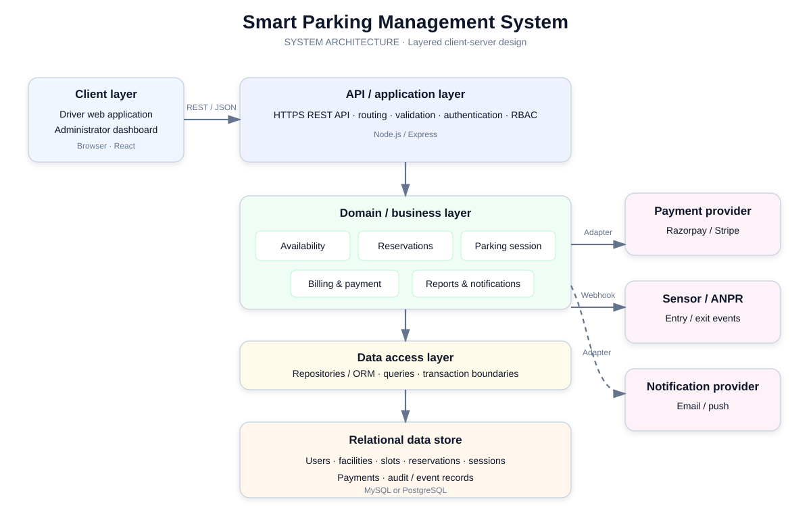

#  Software Architecture Design

## Smart Parking Management System (SPMS)

**Deliverable:** System Architecture Diagram  
**Industry mapping:** System architecture planning  
**Status:** Proposed logical architecture. The repository currently contains requirements and diagrams, not an implemented application.

## 1. Architecture overview

SPMS is planned as a layered client-server web application. Drivers and facility administrators use a browser client. A server-side REST API applies business rules and coordinates persistence and external integrations. A relational database is the system of record. Payment services and IoT/ANPR equipment remain external systems accessed through adapters.

This is a conceptual architecture consistent with the repository's stated React, Node.js/Express, relational database, payment gateway, and sensor/ANPR plans. It does not claim these components are implemented or deployed.

## 2. System architecture diagram

The diagram is also available as a standalone [SVG](system-architecture.svg).

## 3. Layer responsibilities

| Layer | Responsibilities | Example SPMS modules |
|---|---|---|
| Client / presentation | Render interfaces, collect input, show availability and outcomes | Driver web app, Admin dashboard |
| API / application | Authenticate requests, validate inputs, route use cases, apply authorization | Express routes, controllers, API middleware |
| Domain / business | Enforce booking and slot rules; calculate fees; coordinate entry, exit, payment, reporting | Reservation, Availability, Parking Session, Billing, Reporting services |
| Data access | Persist and query domain records; provide transaction boundaries | Repositories / ORM models |
| Data storage | Durable relational records and indexes | Users, facilities, slots, reservations, sessions, payments, audit events |
| Integration | Translate external protocols and isolate vendor-specific details | Payment gateway adapter; sensor / ANPR webhook adapter; notification provider |

### Request flow

1. A browser client sends an HTTPS request to the API.
2. API middleware authenticates and authorizes it; the application layer validates the command.
3. A domain service applies rules and uses the data-access layer to read or update records transactionally.
4. When required, an integration adapter calls a payment provider or receives a sensor/ANPR event.
5. The API returns a result to the client. Notifications can be sent through the notification integration.

## 4. Client-server design

The browser is the client; the SPMS API is the server. Clients use REST/JSON over HTTPS and do not access the database directly. The server owns authorization, booking decisions, fee calculation, and durable state. Webhook endpoints accept authenticated or verifiable events from external providers. This boundary supports multiple clients later (for example, a mobile app) without duplicating core rules.

## 5. Microservices assessment (conceptual)

The recommended initial deployment is a **modular monolith**: one server-side application, internally divided into clear domain modules and integration adapters, with a shared relational database. The current repository does not demonstrate service deployments, independent data stores, or inter-service messaging.

If scale or team ownership later requires independent deployment, candidate service boundaries are:

- Identity and Access
- Facility and Availability
- Reservation and Parking Session
- Billing and Payment
- Notifications and Reporting

A service split would require explicit API/event contracts, idempotent event handling, observability, retries, and a plan for cross-service consistency. In particular, slot allocation and reservation must prevent double booking; splitting those writes across services prematurely can make that guarantee harder. Treat microservices as a future option, not a description of the current system.

## 6. Quality and planning considerations

- **Consistency:** Reserve a slot and create its booking within a database transaction or equivalent concurrency-safe operation.
- **Security:** Enforce role-based access on the server, hash passwords, validate webhook signatures, and protect secrets.
- **Availability:** Define behavior for payment-provider or sensor outages; retain auditable event status for retries.
- **Scalability:** Index facility, slot status, and reservation time queries; scale stateless API instances behind a load balancer when needed.
- **Maintainability:** Keep HTTP, domain rules, persistence, and vendor integrations in separate modules.

## 7. Industry planning mapping

This design provides a planning baseline for component ownership, trust boundaries, integration points, data responsibilities, and deployment evolution. Before implementation, validate expected traffic, availability targets, payment compliance obligations, sensor connectivity, and operational support needs with stakeholders.
