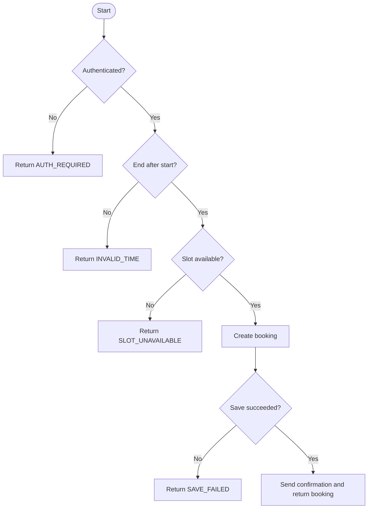

# Software Metrics and Complexity Analysis

## Smart Parking Management System (SPMS)

**Deliverable:** Metrics Calculation Report  
**Industry mapping:** Software quality measurement  
**Measurement status:** Worked baseline using an explicitly defined reservation example. The repository contains no executable application source code, so these figures are not measured codebase totals. Recalculate from source once implementation exists.

## 1. Scope and assumptions

The source tree currently contains documentation and diagrams only. To demonstrate the requested techniques without implying that code exists, this report analyzes one language-neutral `reserveSlot` example and estimates function points from the documented requirements. Counts below are reproducible assumptions for coursework, not an automated scan or a certified sizing estimate.

### Reservation example used for the worked metrics

```text
reserveSlot(user, slot, start, end)
  if not authenticated(user) return AUTH_REQUIRED
  if end <= start return INVALID_TIME
  if not slot.isAvailable(start, end) return SLOT_UNAVAILABLE
  booking = createBooking(user, slot, start, end)
  if not booking.save() return SAVE_FAILED
  sendConfirmation(user, booking)
  return booking
```

## 2. Size-oriented measures

| Measure | Worked value | Counting rule / interpretation |
|---|---:|---|
| Logical source lines (SLOC) | 8 | Nonblank pseudocode lines; excludes the signature, braces (none shown), and comments. This is the example's size only. |
| Physical lines | 9 | Includes the function signature and eight body lines. |
| Estimated project SLOC | Not available | No implementation source files are present to count. |
| Defect density | Not available | Requires a defined defect count and implemented code size. Do not infer a zero-defect result from absent code. |

## 3. Halstead metrics (worked example)

For a reproducible lexical inventory, count the following tokens in the example body. Treat each listed operation as an operator; identifiers and constants are operands. Keywords `if`, `return`, and `not` are operators. Parentheses, commas, and member-access punctuation are excluded. The grouping is a declared classroom convention; another tokenizer may produce different counts.

| Token class | Distinct operators / operands | Distinct count | Total occurrences |
|---|---|---:|---:|
| Operators (n1 / N1) | `if`, `not`, `<=`, `return`, `=`, `authenticated`, `.isAvailable`, `createBooking`, `.save`, `sendConfirmation` | 10 | 18 |
| Operands (n2 / N2) | `user`, `slot`, `start`, `end`, `AUTH_REQUIRED`, `INVALID_TIME`, `SLOT_UNAVAILABLE`, `booking`, `SAVE_FAILED` | 9 | 19 |

The operator inventory counts the call to `authenticated` as an operator. The example excludes the function signature and counts each decision test, return, assignment, and call consistently.

| Metric | Formula | Result |
|---|---|---:|
| Vocabulary | n = n1 + n2 | 19 |
| Length | N = N1 + N2 | 37 |
| Estimated length | N-hat = n1 log2(n1) + n2 log2(n2) | 61.8 |
| Volume | V = N log2(n) | 156.8 bits |
| Difficulty | D = (n1 / 2) × (N2 / n2) | 10.6 |
| Effort | E = D × V | 1,656.8 |
| Time (optional model) | T = E / 18 seconds | 92.0 seconds |

**Inventory note:** Operand occurrences: `user` 3, `slot` 2, `start` 3, `end` 3, `AUTH_REQUIRED` 1, `INVALID_TIME` 1, `SLOT_UNAVAILABLE` 1, `booking` 4, and `SAVE_FAILED` 1 (N2 = 19). Operator occurrences total 18 (N1). The time conversion uses the conventional 18 mental-discrimination-per-second assumption and should be treated as a rough model, not elapsed developer time.

## 4. Function Point Analysis (indicative estimate)

Counted logical functions implied by the requirements; complexity is assumed low for this teaching estimate. Standard low-complexity weights are applied: EI=3, EO=4, EQ=3, ILF=7, EIF=5.

| Function type | Count | Assumed complexity | Weight | Subtotal | SPMS examples |
|---|---:|---|---:|---:|---|
| External Inputs (EI) | 3 | Low | 3 | 9 | Register/update profile; configure facilities/slots; create/cancel reservation (grouped as three inputs) |
| External Outputs (EO) | 2 | Low | 4 | 8 | Booking confirmation/receipt; admin occupancy/revenue report |
| External Inquiries (EQ) | 2 | Low | 3 | 6 | Search availability; view booking/payment history |
| Internal Logical Files (ILF) | 4 | Low | 7 | 28 | Users; facilities/slots; reservations/sessions; payments |
| External Interface Files (EIF) | 2 | Low | 5 | 10 | Payment provider data; sensor/ANPR event interface data |
| **Unadjusted Function Points (UFP)** |  |  |  | **61** | Sum of subtotals |

Illustrative adjustment: assume the 14 General System Characteristic ratings average 2.5/5, yielding `TDI = 35`; `VAF = 0.65 + (0.01 × 35) = 1.00`; adjusted FP = `61 × 1.00 = 61`.

The transaction groupings and complexity ratings are provisional. A formal estimate requires validated transaction boundaries, data-element and file-type counts, and stakeholder review. No adjustment factor or FP count is measured from implemented software.

## 5. Cyclomatic complexity and control flow

The example has four binary decision points: authentication, time validity, availability, and save success. With one connected component, `V(G) = decisions + 1 = 4 + 1 = 5`.

Equivalent edge/node check for the graph below: `E = 11`, `N = 8`, `P = 1`, so `V(G) = E - N + 2P = 11 - 8 + 2 = 5`.



The score of 5 indicates five linearly independent paths for this example. A practical test basis should cover each decision outcome, including all four early/error returns and the successful reservation path. Concurrency, retry, and external gateway behavior need additional scenarios beyond this simple control-flow model.

## 6. Quality interpretation and next measurement

- Use complexity to identify functions that may need decomposition and focused path testing; it is a signal, not a defect verdict.
- Recompute SLOC, Halstead counts, and cyclomatic complexity from the implemented language with a declared tool and counting configuration.
- Revisit the FP inventory with stakeholders after API and data models are specified; avoid treating the provisional 61 FP as contractual scope.
- Track trends consistently across releases and pair size/complexity with defects, test coverage, latency, and operational incidents.

## 7. Industry mapping

Software quality measurement makes scope and structural risk visible for estimation, review, and test planning. This worked baseline demonstrates calculation methods while preserving the distinction between a requirements-level estimate and measurements from delivered software.


