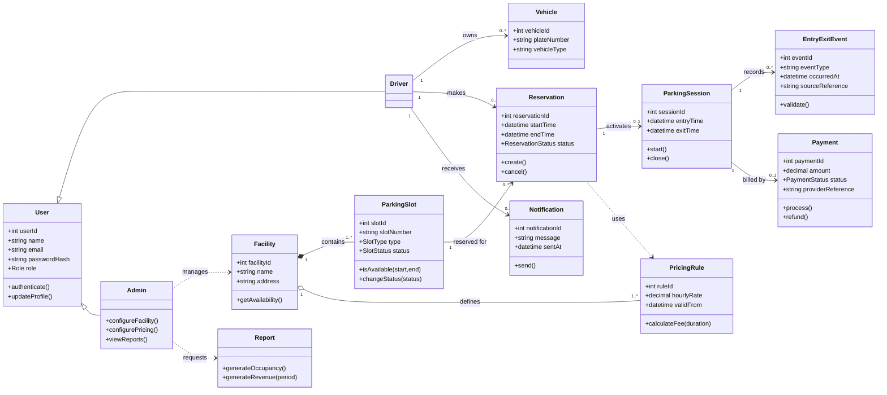
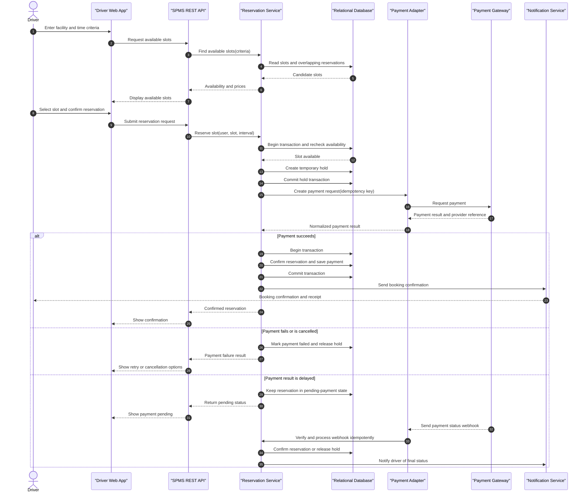
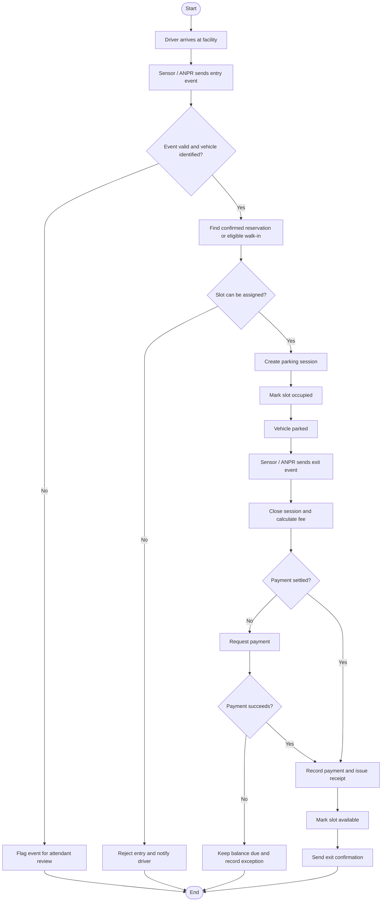

# UML Design - Smart Parking Management System

## 1. Class Diagram

### Core class constraints

- `User.role` distinguishes driver and administrator permissions.
- A slot has one current status; a reservation must pass an availability check before confirmation.
- A reservation may activate at most one parking session; a session has at most one finalized payment.
- Entry and exit events are retained with timestamps and source references for audit and retry handling.
- Pricing rules are associated with a facility and evaluated for the applicable parking interval.

## 2. Sequence Diagram - Search and reserve a slot

## 3. Activity Diagram - Parking entry, stay, and exit

## 4. Diagram scope

The class model describes the main domain entities and associations. The sequence diagram details the reservation/payment interaction. The activity diagram models entry through exit, including exception branches for invalid events, unavailable slots, and failed payments.

